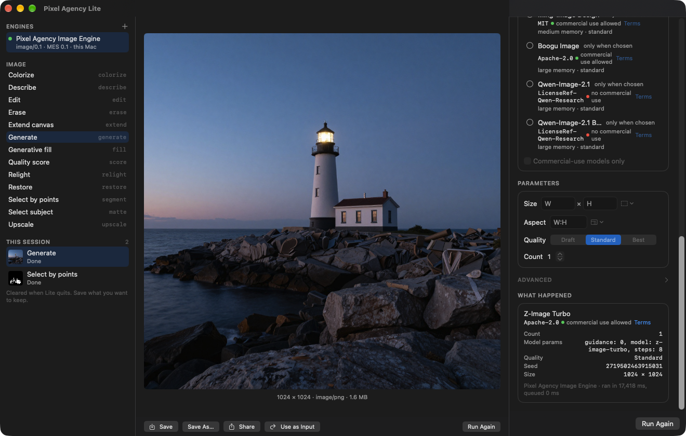

# Pixel Agency Lite

A small macOS app for using **media engines**: pick an engine on your network, choose an operation, set its controls,
drop in an image, run it, and save the result. Lite is the reference client of the
[Media Engine Specification (MES)](https://github.com/xocialize/media-engine-spec): everything it does goes through the open MES SDKs, and every
control it shows comes from the engine's own descriptors.

> **Status: L2 complete** (Lite-PRD §9).
> - **L1:** with only the MES mock engine, every Image operation runs end to end from Lite, and its controls come
>   entirely from descriptors. Lite passes the MES client conformance suite through `lite-run`, the same workflow
>   without a window.
> - **L2:** Lite runs against the real [Pixel Agency Image Engine](https://github.com/xocialize/pixel-agency-image-engine)
>   with real models.
>   - The headless workflow ran all 13 Image operations, including a research model named (Qwen-Image 2.1 Turbo).
>   - The signed, sandboxed app was checked live: it found the engine over Bonjour, generated with Qwen-Image 2.1
>     Turbo (stamped "may not be used commercially"), and carried the result into Select by points.
>   - With the point picker, which is new in L2, SAM 2.1 selected the whole bicycle from three include points and
>     one exclude.
> - Video operations arrive with the Video profile (L3, after the image workflow, D-16).



## Contents

| Path | What |
|---|---|
| `Sources/PixelAgencyRun` | **The run workflow's model** (an open package that Pixel Agency Desktop embeds too):<br/>• engines: discovery, pairing, credentials;<br/>• a run: inputs, controls from the descriptor, progress, results and what happened;<br/>• the session list, the working folder, masks. |
| `Sources/PixelAgencyRunUI` | **The run workflow's views** (MESFormsUI and DesignScaffold):<br/>• engines, operations and this session's runs;<br/>• the canvas: input, progress and previews, results with Save, Share, Use as Input;<br/>• the controls from the descriptor, media slots, the mask brush with "select subject";<br/>• what happened;<br/>• working-folder onboarding. |
| `App/` | **Pixel Agency Lite.app:** a thin SwiftUI app around the workflow.<br/>• Sandboxed: user-selected files, app-scope bookmarks, network client only.<br/>• Declares the `_mes-engine._tcp` Bonjour service.<br/>• Settings: the working folder, and commercial-use only. |
| `Sources/LiteRun` | `lite-run`: the same workflow without a window, for the client conformance suite |
| `Tests/` | The L1 test, at the model level, against the mock engine; client conformance through `lite-run` |
| [`docs/HOW-LITE-TALKS-TO-ENGINES.md`](docs/HOW-LITE-TALKS-TO-ENGINES.md) | **Start here:** every exchange Lite has with an engine, in order, with the code and the spec section for each (LITE-13) |

## Embedding the run workflow

Pixel Agency Desktop embeds these packages (LITE-16). Four hooks make that possible without forking them:

- **An engine inside the app.** `EngineDirectory.addLocal(_:)` lists an in-process engine (MESInProcess) first, and
  connects to it without the network. Desktop's built-in engine is one; Lite has none.
- **Runs executed elsewhere.** Set `RunWorkflow.executor` to a `RunExecutor` and each run it starts is handed to the
  executor, which reports progress and results back through the session's `report` methods. The views show the run
  as they show any other. Desktop's executor turns each run into a durable ticket that stores results in its library
  before confirming them.
- **The views in pieces.** `RunEngineList`, `RunOperationList`, `RunSessionList`, `RunWorkflowCanvas`,
  `RunWorkflowInspector` and `runWorkflowPairing(_:)` let an app compose the workflow into its own window.
  `RunWorkflowView` is Lite's arrangement of them.
- **An allow-list.** `EngineDirectory.admits` decides which engines the app may use. A refused engine leaves
  `entries` for `refused`, and `connect` and pairing refuse it. The engine list says how many are hidden. Lite admits
  every engine; Desktop narrows it to an administrator's list (managed settings).

`RunWorkflow.useAsInput(_:)` also takes a plain `MediaItem`, so an app can put its own files into a run.

## Building

The MES SDKs come from [media-engine-spec](https://github.com/xocialize/media-engine-spec) at a tag (0.1.x).

```bash
swift test
```

The app (signed with your development team; see `App/Pixel Agency Lite.xcodeproj`):

```bash
xcodebuild -project "App/Pixel Agency Lite.xcodeproj" -scheme "Pixel Agency Lite" -derivedDataPath build/DerivedData build
```

Lite finds any MES engine on this Mac or your network on its own; one with real models is the Pixel Agency Image
Engine. To try it without one, run the MES mock engine from a clone of
[media-engine-spec](https://github.com/xocialize/media-engine-spec):

```bash
git clone https://github.com/xocialize/media-engine-spec.git
```

```bash
swift run --package-path media-engine-spec mes-mock-engine --delay-ms 250
```

## Licence

Apache-2.0 ([LICENSE](LICENSE)).
