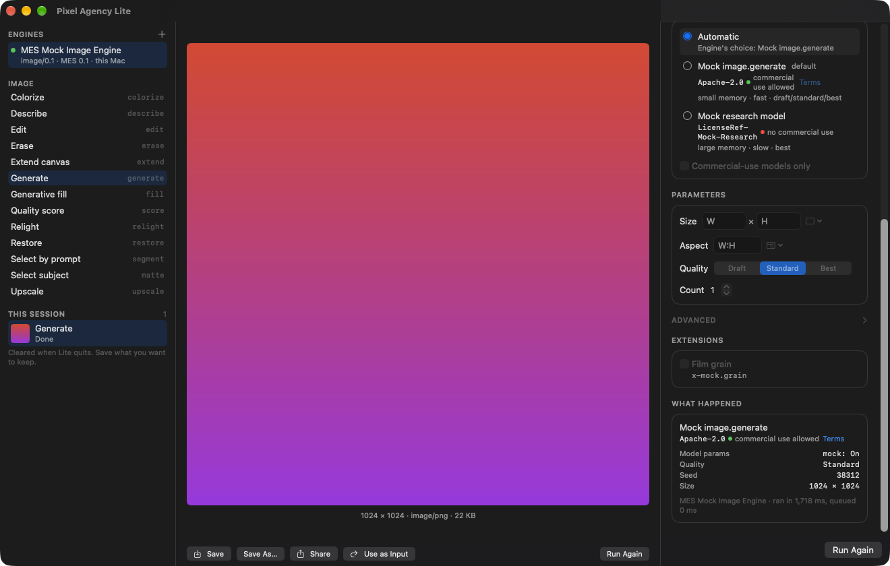

# Pixel Agency Lite

A small macOS app for using **media engines**: pick an engine on your network, choose an operation, set its controls,
drop in an image, run it, and save the result. Lite is the reference client of the
[Media Engine Specification (MES)](../media-engine-spec): everything it does goes through the open MES SDKs, and every
control it shows comes from the engine's own descriptors.

> **Status: L1 complete; L2 under way** (Lite-PRD §9).
> - **L1:** with only the MES mock engine, every Image operation runs end to end from Lite, and its controls come
>   entirely from descriptors. Lite passes the MES client conformance suite through `lite-run`, the same workflow
>   without a window. The signed, sandboxed app was checked live against the mock.
> - **L2:** Lite's run workflow ran all 13 Image operations against the real
>   [Pixel Agency Image Engine](../pixel-agency-image-engine) with real models, including a research model named
>   (Qwen-Image 2.1 Turbo). It ran through `lite-run`, the same `RunSession` the app uses. Data inputs are new:
>   a point picker for `image.segment`. Still to do: the in-app check against the real engine.
> - Video operations arrive with the Video profile (L3, after the image workflow, D-16). Nothing here is published
>   yet.



## Contents

| Path | What |
|---|---|
| `Sources/PixelAgencyRun` | **The run workflow's model** (an open package that Pixel Agency Desktop embeds too):<br/>• engines: discovery, pairing, credentials;<br/>• a run: inputs, controls from the descriptor, progress, results and what happened;<br/>• the session list, the working folder, masks. |
| `Sources/PixelAgencyRunUI` | **The run workflow's views** (MESFormsUI and DesignScaffold):<br/>• engines, operations and this session's runs;<br/>• the canvas: input, progress and previews, results with Save, Share, Use as Input;<br/>• the controls from the descriptor, media slots, the mask brush with "select subject";<br/>• what happened;<br/>• working-folder onboarding. |
| `App/` | **Pixel Agency Lite.app:** a thin SwiftUI app around the workflow.<br/>• Sandboxed: user-selected files, app-scope bookmarks, network client only.<br/>• Declares the `_mes-engine._tcp` Bonjour service.<br/>• Settings: the working folder, and commercial-use only. |
| `Sources/LiteRun` | `lite-run`: the same workflow without a window, for the client conformance suite |
| `Tests/` | The L1 test, at the model level, against the mock engine; client conformance through `lite-run` |
| [`docs/HOW-LITE-TALKS-TO-ENGINES.md`](docs/HOW-LITE-TALKS-TO-ENGINES.md) | **Start here:** every exchange Lite has with an engine, in order, with the code and the spec section for each (LITE-13) |

## Building

The MES SDKs come from a sibling checkout of `media-engine-spec` until it's published.

```bash
swift test
```

The app (signed with your development team; see `App/Pixel Agency Lite.xcodeproj`):

```bash
xcodebuild -project "App/Pixel Agency Lite.xcodeproj" -scheme "Pixel Agency Lite" -derivedDataPath build/DerivedData build
```

To try it with real models, run the [Pixel Agency Image Engine](../pixel-agency-image-engine); Lite finds it on its
own:

```bash
swift run --package-path ../pixel-agency-image-engine pixel-agency-image-engine
```

To try it without a real engine, run the MES mock engine from the `media-engine-spec` checkout. Lite finds it on its own:

```bash
swift run --package-path ../media-engine-spec mes-mock-engine --delay-ms 250
```

## Licence

Apache-2.0 ([LICENSE](LICENSE)).
