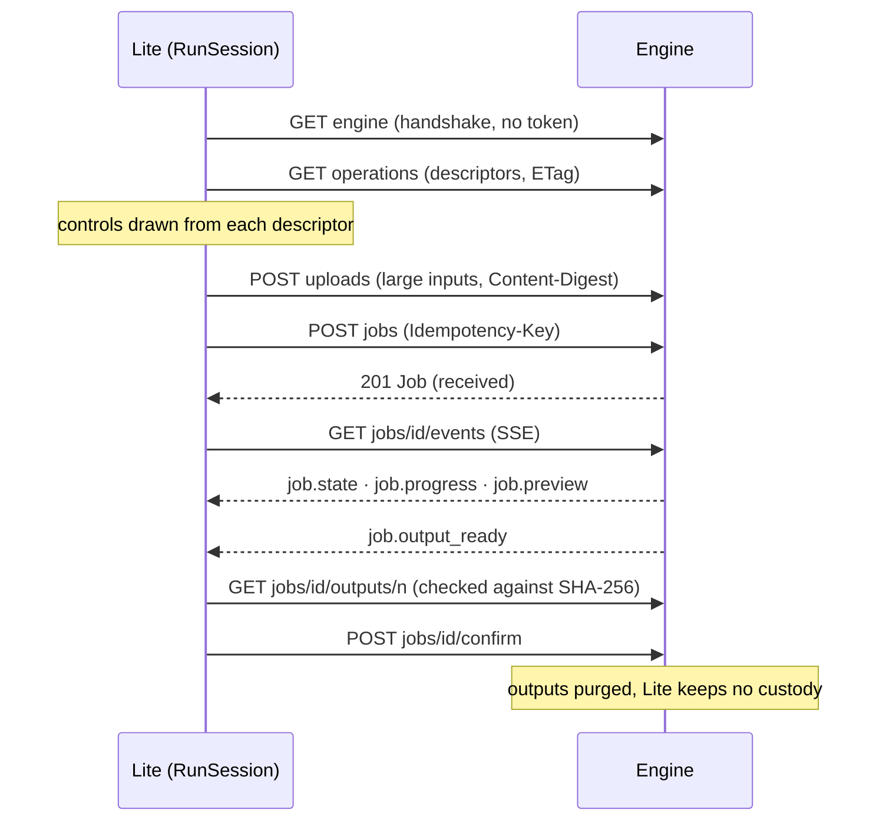

# How Lite talks to an engine

Pixel Agency Lite is the reference client of the [Media Engine Specification](../../media-engine-spec/spec/base.md)
(MES). This guide walks through every exchange Lite has with an engine, in the order they happen, with the code
that does it and the part of the spec it follows. Read it with `Sources/PixelAgencyRun` open: that package is the
whole engine path. The views in `PixelAgencyRunUI` only display it.

Lite adds nothing private to MES. Everything below goes through the open SDKs: MESClientKit for the wire and
MESFormsUI for the controls. Pixel Agency Desktop embeds this same package, so it reaches engines the same way.



## 1. Finding engines

**Spec:** Base §3.1 (DNS-SD) and §4 (engine information).

`EngineDirectory.startBrowsing()` browses `_mes-engine._tcp` with `EngineBrowser.browse()` (Network.framework's
`NWBrowser`).
- **What each engine's TXT record says:** its id, profiles, Base versions, auth mode and load. The engine list shows
  these before Lite has connected to anything (LITE-1).
- **Engines on this Mac** register on the loopback interface. `NWBrowser` doesn't report the DNS-SD local-only
  pseudo-interface, which is why Base §3.1 says SHOULD use loopback.
- **Engines added by address** (`add(url:)`) are read with `GET engine`, which needs no token, even in paired mode.

The app declares `_mes-engine._tcp` under `NSBonjourServices` and explains local-network use in
`NSLocalNetworkUsageDescription`. Without both, a sandboxed app sees nothing.

## 2. Pairing

**Spec:** Base §5.

A paired engine answers everything except the handshake and the pairing endpoints with `401` until the client pairs
(Base §3.3).
1. `EngineDirectory.beginPairing(_:)` calls `Pairing.begin`.
   - It opens TLS and accepts the engine's self-signed certificate provisionally.
   - It checks that certificate against the `tls.fingerprint_sha256` the engine advertises.
   - It sends this client's P-256 key and a random nonce (`POST pairings`).
   - It computes the 6-digit code from both fingerprints and both nonces.
2. The pairing sheet shows the code. The engine's operator sees the same code and approves. A different code means
   someone is in between.
3. `completePairing(_:wait:)` calls `POST pairings/{id}/confirm` with `Prefer: wait=60`. On approval it gets a bearer
   token, handed out once.
4. **What Lite keeps:** the token and the certificate's fingerprint, stored as a `PairedEngine` in the Keychain
   (`KeychainCredentialStore`). It also keeps its own key there. All of these are secrets, so none goes in
   UserDefaults or files.

From then on `connect(_:)` returns an `HTTPEngineConnection(paired:)`. It sends the token and accepts only the
pinned certificate, even when the engine's address changes.

## 3. Operations and their controls

**Spec:** Base §6, and the Image profile's vocabulary (§2).

`RunWorkflow.select(_:)` reads `GET operations`. MESClientKit revalidates the list with its `ETag`, so asking again
costs a `304`.
- **One run per operation.** Choosing an operation creates a `RunSession`, which holds an `OperationFormModel` built
  from the descriptor.
- **No per-operation code (LITE-4).** The model picks a widget for every parameter from its JSON Schema and its
  `x-mes-ui` hints. The inspector shows the model offers, each with its licence, and the declared extensions, all via
  MESFormsUI's `OperationFormContent`. An operation an engine adds tomorrow gets the same treatment.
- **Only what you changed is sent.** A control showing a default sends nothing; the engine applies the same default
  and reports it.

## 4. Inputs

**Spec:** Base §8 (uploads, inline inputs), and Image profile §1 (media types, masks, orientation).
- **Media inputs** are `MediaItem`s: files dropped, opened or pasted, or a previous result (`RunResult.asInput`,
  LITE-12).
- **Sending them.** Before submitting, `RunSession.run()` turns each into an `InputValue` with
  `engine.input(contentsOf:inlineLimit:)`:
  - **Inline:** files up to the engine's `limits.max_inline_bytes` go in the request as base64.
  - **Uploaded:** larger files go to `POST uploads` with a `Content-Digest`, and the request names the upload.
  - Lite keeps no custody, so it never serves grants (§9).
- **Masks** follow Image §1.6: 8-bit grey, the image's size, white where the engine may change pixels.
  - `MaskRaster` paints brush strokes into exactly that.
  - "Select subject" runs `image.matte` on the engine and takes its mask (`RunWorkflow.selectSubject(of:)`).

## 5. Submitting

**Spec:** Base §7.1 and §12.

`form.request(media:)` builds the `JobRequest`: the operation, the inputs, the parameters you set, the model if you
chose one, the licence and remote policy (LITE-9, LITE-10), and any extensions you turned on.
- **Idempotency.** `RunSession` submits it with a fresh `Idempotency-Key`. A retried submission then returns the
  original job instead of making a second one.
- **Errors and retries.** Errors arrive as `MESClientError.engine` with the §12 code. `HTTPEngineConnection` waits out
  `429 busy` and `503 no_capacity` for as long as `Retry-After` says, then retries. Everything else ends the run with
  its message.

## 6. Following the job

**Spec:** Base §7.2 and §11.

`RunSession` follows `GET jobs/{id}/events`, a Server-Sent Events stream. It resumes with `Last-Event-ID` if the
connection drops.
- **Updates.** `job.state` and `job.progress` update the phase that the canvas shows. `job.preview` replaces the
  picture while the job runs. `job.warning` adds to the job's warnings.
- **The end.** The stream is read until `job.output_ready` or `job.ended`, then Lite takes one final snapshot
  (`GET jobs/{id}`).
- **Cancel** is `DELETE jobs/{id}` (release). The engine ends the job `cancelled`, and `RunSession.cancel()` shows it
  so.

## 7. Collecting, and what happened

**Spec:** Base §7.3, §10 and §13.

1. **Download.** On success, `RunSession.collect` downloads every output (`GET jobs/{id}/outputs/{n}`) into the
   session's folder and checks it against the SHA-256 the engine reported.
2. **Confirm.** Then it confirms (`POST jobs/{id}/confirm`), and the engine purges its copy at once. Lite keeps no
   custody: the results live in the session folder until you save them, and the folder is deleted when Lite quits
   (LITE-11).
3. **What happened (LITE-8).** This panel reads the job's result:
   - the model that ran and its licence, including whether commercial use is allowed;
   - the effective parameters, such as a snapped size or the seed actually used;
   - warnings, and any remote provider.

## 8. Conformance

**Spec:** Base §16.

`lite-run` is this same workflow without a window. The MES client conformance suite drives it through seven
scenarios and judges it from the engine's side:
- **The scenarios:** busy, no capacity, a failed job, a cancelled job, an unknown error code, and expired outputs.
- **What's judged:** what it sent, whether it honoured `Retry-After`, what it left behind, and how it exited.

`swift test` runs it (LITE-14):

```bash
swift test --filter clientConformance
```

## Where to change things

| You want to | Look at |
|---|---|
| Support a new engine feature | MESClientKit in `media-engine-spec`, then `RunSession` |
| Change how controls look | MESFormsUI (`OperationFormContent`, `FieldEditor`) |
| Change Lite's window | `PixelAgencyRunUI` |
| Change what's kept, and where | `SessionLog`, `ResultExporter`, `WorkingFolder` |
